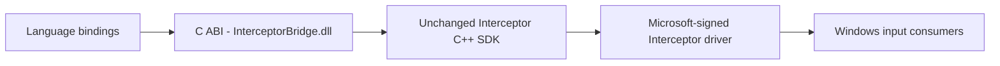

# Interceptor MultiLang - Windows Input SDK for Modern Languages

Capture, modify, block and generate keyboard, mouse and compatible gamepad input on Windows using **Python, JavaScript, TypeScript, C#, Java, Go, Rust, C and C++**.

<!-- full-version-contact:start -->
> [!IMPORTANT]
> **Get the full driver version without demo restrictions**
>
> **Discord username: `titancsa`**
>
> Open Discord, choose **Friends > Add Friend**, enter **`titancsa`**, then send a direct message. Ask for the **full driver version without the demo time limit**, and mention **Interceptor MultiLang**.
>
> The demo limit belongs to **Interceptor**, the driver used by this project. Ask for pricing and the appropriate license / activation instructions; the application or wrapper source keeps its existing license.
<!-- full-version-contact:end -->

**[Download the complete package](https://github.com/TitanCSA/Interceptor-MultiLang/releases/latest)** | [API and input fields](API.md) | [Examples](https://github.com/TitanCSA/Interceptor-MultiLang/tree/main/examples/)

## What is Interceptor?

[Interceptor](https://github.com/TitanCSA/Interceptor) is a **Microsoft-signed Windows kernel filter driver** with a C++ SDK. A filter driver sits in a supported physical device's Windows input stack, allowing your application to receive its input before Windows applications consume it. Each event identifies its source, so you can treat two keyboards, mice or controllers differently.

Your application can forward an event unchanged, edit its state, block it, or generate input for an existing supported source. For example, you can remap a keyboard key, invert mouse movement, change a gamepad's stick response, or build an accessibility tool. Changes travel back through the driver's input path. Without an active capture application, physical input passes through normally; closing the application releases capture.

The driver supports **keyboard, mouse, HID gamepad, XInput/XUSB, XInputHID and GIP** on **Windows 10 1709+ / Windows 11 x64**. Compatible controller profiles include **DualShock 4 / DS4, DualSense, wired Xbox 360, Xbox One and Xbox Series X|S**; support depends on connection, descriptor and protocol. See the [compatibility guide](https://github.com/TitanCSA/Interceptor/blob/main/docs/COMPATIBILITY.md).

Interceptor independently evolves the input-interception workflow popularized by [oblitum/Interception](https://github.com/oblitum/Interception), with its own implementation and API. It is not affiliated with oblitum or ABI-compatible with the original Interception SDK.

**Interceptor MultiLang is the wrapper that makes this driver accessible from other languages.** One native DLL and small language bindings expose the same simple workflow: **receive inputs, edit their state, send them back**. Counts, source routing and capture context management stay inside the wrapper. HID controls remain descriptor-driven and retain repeated axes, buttons, hats, wide values and unknown report bytes. The matching Interceptor driver is still required; its installer is included in the complete release ZIP.

## Start

1. Extract the complete release ZIP. Run **Install.cmd**, accept the Windows administrator prompt, and restart if requested. The GUI installer is also included in `driver/`. No compiler is needed to use the prebuilt bindings.
2. Open an **administrator terminal**, close other capture/remapper applications, and run an example in your language. Install only the full **Interceptor 1.4.22.0** driver for this package; split Interceptor editions and Interception V2 use different interfaces.

For Python:

```powershell
python -m pip install .\packages\titancsa_interceptor-1.0.0-py3-none-win_amd64.whl
python .\examples\python\remap.py
```

The action is deliberately small:

```python
from interceptor import Interceptor

with Interceptor() as io:
    while True:
        inputs = io.receive()
        for event in inputs:
            if event.kind == "mouse" and not event.state.flags & 1:
                event.state.y = -event.state.y
        io.send(inputs)
```

`receive()` consumes captured input. **Send the entire batch**, including families you did not change. Set an entry's `blocked` flag to deliberately suppress it. Closing the client releases capture; it also cancels a pending wait. Physical **Ctrl+Alt+Delete** remains the driver's recovery shortcut.

For devices connected after installation, call `initialize()` / `Initialize()` before entering the loop. It associates supported devices using the installed packages and reports `ready`, `reboot_required` and any error. If a restart is required, restart before capturing. It does not download or install a driver silently.

## Choose your language

| Language | Runtime | Start from the extracted package |
| --- | --- | --- |
| Python | Python 3.10+, x64 | Install the bundled wheel, then `python examples/python/remap.py` |
| JavaScript | Node.js 20+, x64 | `node examples/node/remap.cjs` |
| TypeScript | Node.js 24+, x64 for direct `.cts` execution | `node examples/typescript/remap.cts` |
| C# / .NET | .NET 8+ | `dotnet run --project examples/dotnet/Remap.csproj` |
| Java | JDK 22+ | Compile the Java example, then launch with `--enable-native-access=ALL-UNNAMED`; [commands](API.md#java) |
| Go | Go 1.21+, Windows amd64 | From `examples/go`: `go run .` - no cgo compiler |
| Rust | Rust 1.82+, Windows MSVC toolchain | `cargo run --manifest-path examples/rust/Cargo.toml` |
| C | Windows x64 C compiler | Use `native/InterceptorBridge.h`, `InterceptorBridge.lib` and the DLL |
| C++ | C++17 | Use the unchanged two-file SDK in `sdk/`; [example](https://github.com/TitanCSA/Interceptor-MultiLang/blob/main/examples/cpp/main.cpp) |

The release also contains local **wheel, npm TGZ and NuGet packages** for use in your own projects. They are downloadable files; this repository does not imply publication on PyPI, npm or NuGet.org. The .NET assembly is also usable from F#, VB.NET and compatible PowerShell, and the Java JAR can be consumed by JVM languages such as Kotlin.

Other languages with a Windows C FFI can use the documented [C ABI](https://github.com/TitanCSA/Interceptor-MultiLang/blob/main/native/InterceptorBridge.h). Ready-made bindings above are tested separately; a browser or WebAssembly sandbox cannot load the Windows DLL directly. All capture processes must be **Windows x64**.

## Small API

| Operation | Purpose |
| --- | --- |
| `receive(timeout)` | Wait for a mixed batch. `0` checks immediately; omitted/default waits indefinitely |
| `send(inputs)` | Forward the current batch, automatically dispatching types and counts |
| `inject(...)` | Generate input for an existing source; choose its capture token or the first matching device |
| `devices()` | Get kind, capture-scoped token, VID/PID, name and hardware ID |
| `initialize()` | Associate newly connected supported devices using installed driver packages |
| `descriptor(token, report)` | Get common descriptor data, or the raw HID report descriptor where available |
| `info()` | Read driver/capability/demo information without creating capture |
| `cancel()` | Wake a pending receive without closing the client |
| `discard(inputs)` | Explicitly suppress an entire pending batch |
| `close()` | Cancel waits and release capture; context managers / dispose / drop do this too |

Names use each language's conventions: .NET has `Receive`, `Send`, `GetInfo`, `GetDescriptor`, `Dispose`; Rust uses `cancel_handle()` for cross-thread cancellation. See the [language examples and API notes](API.md).

For example, Python can generate a relative movement with:

```python
io.inject("mouse", x=200)  # Driver mouse input, in relative units.
```

This uses the driver path. Pixel displacement also depends on Windows acceleration and application settings. For HID injection, pass a valid report for the selected device; the wrapper does not invent a report layout.

## How it works



Capture opens lazily on the first input/device operation. There is no wrapper service, extra kernel driver, fixed polling interval or hidden forwarding loop. Events cross the language boundary in batches; input payloads use native binary structures. Node's asynchronous receive uses its standard async worker facility so the JavaScript event loop stays responsive.

One client owns capture at a time. Finish or discard a batch before receiving another. Successful sends track accepted entries, so retrying the same current batch does not replay its accepted prefix. Metadata and payload snapshots can be inspected after receiving another batch, but old batches cannot be sent. HID state describes the **current report**, rather than a fabricated cumulative controller state.

## Demo and compatibility

The original driver's **one-hour allowance per Windows boot** is unchanged. It starts at the first successful capture, including device enumeration that opens capture. Read-only `info()` does not start it. Closing applications or reopening a wrapper does not reset it. At expiry, capture/injection stop and physical input returns to passthrough. Restart Windows for a new demo period. For unrestricted licensing, add **titancsa** on Discord.

Device support depends on the existing driver's supported connection, descriptor and protocol. See [Interceptor compatibility](https://github.com/TitanCSA/Interceptor/blob/main/docs/COMPATIBILITY.md). The wrapper does not add new kernel device profiles. The **driver package** is Microsoft-signed; the wrapper DLL, language packages and examples have their own signature status.

## Build and validate

The source tree contains `native/`, the two-file `sdk/`, `bindings/`, `examples/`, `tests/` and `licenses/`. No kernel source is included.

```powershell
.\Build.ps1 -Packages -IncludeDriver
.\Build.ps1 -Test
```

Building the DLL requires Visual Studio 2022 C++ tools, a Windows SDK and CMake. Node headers/import libraries are downloaded from Node.js and checked against its official SHA-256 manifest if not cached. Optional packages use the corresponding installed language tools. `-IncludeDriver` downloads the pinned, hash-verified Interceptor installers without executing installation.

Tests use an explicitly selected **synthetic backend**, never implicit host capture. Coverage includes all six families, Unicode, exact 64-bit identities, repeated HID usages, null hats, binary fields, retries, stale batches, cancellation and close races. Native fixture checks also run under AddressSanitizer. Live Windows 11 tests use the Microsoft-signed driver with Secure Boot enabled and owned virtual keyboard, mouse and HID gamepad fixtures. These checks are not a certification of every physical model or runtime version.

User-mode wrapper/SDK source is [MIT licensed](https://github.com/TitanCSA/Interceptor-MultiLang/blob/main/LICENSE). The driver has [separate binary terms](https://github.com/TitanCSA/Interceptor-MultiLang/blob/main/licenses/BINARY-LICENSE.txt). Use only on systems you own or are authorized to manage. Software is provided as-is to the extent permitted by law; users are responsible for lawful use, and the authors do not authorize or accept responsibility for misuse.
